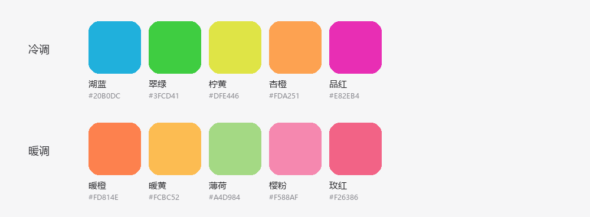

# 工作区总览（dsh-workspace-view）设计

- 日期：2026-11-10
- 状态：待评审
- 作者：与用户共同敲定

## 1. 意图与为什么

用户打开 DSH 的行为是「先扫一眼各项目最近动了什么，再决定做哪件事」。现在唯一的浏览面是左侧栏那份工作区/会话清单，它有三个结构性毛病：

1. 侧栏宽度是布局层写死的 264–420px（默认 280px），横向注定不够；
2. 工作区默认全部展开，纵向被会话撑满，只能滚轮找人；
3. 折叠、重命名都存在，但入口只在悬停工作区行时出现，等于没有。

所以问题不是「怎么折叠」，而是**没有一块适合扫视的地方**。本设计新增一个全宽页面：侧栏图标栏进入，主区域渲染，横向空间充足；用户可以在页面上**自建分组**把工作区归到一起，并一眼看到每个项目最近的会话。

## 2. 目标 / 非目标 / 反向目标

**目标**

- 一块全宽、可滚动的「工作区总览」页面，从侧栏图标栏一键进入。
- 工作区可被用户分到自建的分组里；分组可新建、重命名、删除、排序。
- 每张工作区卡片直接显示最近 3 条会话（标题、相对时间、状态），点击即进入该会话。
- 默认排序让「最近动过的」浮上来：卡片组内按最近活动降序。
- 分组与折叠状态在刷新、重启后保持。
- 与官方侧栏共存，互不干扰；官方清单一个字节都不改。

**非目标（v1 不做）**

- 不在本页做工作区的重命名、删除、归档、置顶（这些都留在侧栏；页面只读展示 workspace 元数据）。
- 不做嵌套分组、不做标签/多归属（一个工作区最多属于一个分组）。
- 不做跨设备/跨浏览器同步（分组是这台机器、这个浏览器的视图偏好）。
- 不做分组内手动拖拽排序（组内固定按最近活动排序）。
- 不做自定义颜色、图标、封面。
- 不新增会话内容搜索；只在本页已加载的会话元数据里做过滤。

**反向目标（即使能跑也算失败）**

- 要求用户先去侧栏点开、折叠、记住悬停位置，才能在本页看懂结构。
- 本页出现后，侧栏的选中态/导航错乱，或从本页进入会话后无法正常回到官方界面。
- 分组只在内存里，刷新即丢。
- 为了显示最近活动而给每个会话建立 Session 绑定、拉取历史，导致页面卡顿。

## 3. 约束

- 宿主是 DSH Web/Desktop 客户端；插件按官方 client plugin 形态交付（`package.json` 的 `dsh.client` + 无副作用的 Host 入口 + 一份 `cordis.patch.yml`），通过 `plugin_manager install_bundle` 安装到当前 profile。
- 页面挂在 root 作用域的 `main` keyed slot 上，key 自定（建议 `dsh-workspace-view`）；侧栏入口挂在 `sidebar.panellist`，两者使用同一个 id，`ctx.layout.selectPanel(id)` 选中页面，`null` 回到对话界面。
- 面板组件可直接使用槽位标准 props：`useWorkspaces`、`useSessions`、`useSessionStatus`、`usePanelInfo`、`useSessionAccess`、`useWorkspaceAccess`（见 §6）。
- 视觉必须走主题 token（亮/暗两套），不写死颜色；中英文案都要有。
- 不能在 profile 目录里手写 `package.json`/`cordis.patch.yml`，也不能在 profile 里跑 pnpm；安装只走 `install_bundle`。

## 4. 方案取舍（已与用户敲定）

| 方案 | 内容 | 结论 |
|---|---|---|
| A. 重写侧栏清单 | 替换 `sidebar.workspaces`，把官方列表重做一遍 | 否决。等于把搜索、拖拽、归档、重命名、水位线、撤销提示全部重做或移植，升级必背锅；且 420px 上限决定了它做不出「扫视」。 |
| B. 全宽总览页 | 新增 global panel：分组 + 工作区卡片 + 最近活动 | **采用**。加法式，官方侧栏与对话页不动；横向空间足够；扫视是它的第一职责。 |
| C. B 的最小版 | 只读扫视，不支持分组 | 否决。用户明确要求「能在页面上对工作区分组」；分组是这页存在的理由，不是附加项。 |

用户原话：「实现工作区总览，在侧栏图标栏加一个入口，主区域开一个全宽页面，我需要在这个全宽页面能够对我的工作区进行分组，方便我查看。」

## 5. 页面设计

### 5.1 结构

```
┌ 工作区总览                                     [搜索] [新建分组] ┐
│ 最近活动                                                          │
│  ● 电动汽车车桩… · 本地启动与功能文档编写        3分钟前           │
│  ● 实习2026 · 简历制作规则整理                  3小时前           │
│  ○ dsh-workspace-view · 新会话                  2天前             │
│                                                                   │
│ ▾ 毕设                                          3 个工作区  ⋯    │
│ ┌────────────────┐ ┌────────────────┐ ┌────────────────┐         │
│ │ 电动汽车车桩…  │ │ 车桩网智能交互…│ │ 碳计量         │         │
│ │ D:\Project\…   │ │ D:\Project\…   │ │ D:\Project\…   │         │
│ │ 3分钟前 · 1条  │ │ 5天前 · 2条    │ │ 20天前 · 1条   │         │
│ │ ● 本地启动与…  │ │ ○ 接口联调     │ │ ○ 数据核对     │         │
│ │ ○ 修复充电桩…  │ │ ○ 汇报材料     │ │                │         │
│ │ +1 条          │ │                │ │                │         │
│ └────────────────┘ └────────────────┘ └────────────────┘         │
│                                                                   │
│ ▾ 实习                                          1 个工作区  ⋯    │
│ ┌────────────────┐                                                │
│ │ 实习2026       │                                                │
│ └────────────────┘                                                │
│                                                                   │
│ ▸ 未分组                                        2 个工作区        │
└───────────────────────────────────────────────────────────────────┘
```

- 顶部工具栏：页面标题「工作区总览」；右侧搜索框（按工作区名、路径、会话标题过滤）与「新建分组」按钮。
- 「最近活动」区：跨所有工作区取最近 5 条非归档、非空白会话，按时间降序；每条 = 状态点 + 工作区名 · 会话标题 + 相对时间。点击进入会话。这一区是「扫一眼」的落点，默认常显。
- 分组区：每个分组一个 section，头部是折叠箭头 + 分组名 + 计数 + 「⋯」菜单；下面是一个自适应网格（`repeat(auto-fill, minmax(280px, 1fr))`，间距 12–16px）。
- 未分组区固定在最后，标题「未分组」，计数。只要存在至少一个工作区，这一段就**始终显示**：为空时渲染成虚线投放区并提示「把卡片拖到这里，移出分组」，这样「移出分组」永远有一个可见的落点，也让「分组之外还有一类」在页面上说得通。
- 全页只有这一个纵向滚动容器；分组很多时也不会出现横向滚动。

### 5.2 工作区卡片

- 第一行：工作区显示名（14px，medium，单行省略）。显示名取 host 的 `title`；`default-workspace` 按当前语言显示本地化默认名。
- 第二行：路径（12px，tertiary，单行省略，`~` 缩写主目录）。
- 第三行：`最近活跃相对时间 · N 条会话`（12px，tertiary）。
- 会话行（最多 3 条）：6px 状态点 + 会话标题（13px，单行省略）+ 相对时间（12px，tertiary，右对齐）。置顶会话排在前。
- 超过 3 条时，卡片底部显示「+N 条」，点击就地展开该卡片的全部会话（本页内状态，不进 localStorage）；展开后再点击收起。
- 卡片右上角悬停出现两个按钮：`＋` 新会话（`startSession(workspaceId)`）与 `⋯`（移动到分组 → 分组列表 + 未分组）。
- 点击会话行：进入对话界面并打开该会话。
- 整个卡片可拖拽：拖到某个分组 section 上即归入该分组；拖到「未分组」即移出分组。拖拽是 v1 唯一的「归组」手势的补充——菜单路径必须同时存在，保证不用鼠标也能归组。

### 5.3 分组头部与操作

- 折叠箭头常显（不是悬停才出现），点击折叠/展开，状态持久化。
- 标题双击或「⋯ → 重命名」就地编辑；Enter 保存，Esc 取消，空标题拒绝。
- 「⋯」菜单项：重命名、上移、下移、删除分组（删除只解散分组，工作区回到未分组，不删除任何注册）。
- 拖拽分组头可调整分组顺序（与「上移/下移」写同一份顺序）。
- 新建分组：生成默认名「新分组」，进入就地编辑状态；允许同名分组吗？——不允许，重名时自动加序号（`新分组 2`）。

### 5.4 搜索与空状态

- 搜索非空时：忽略分组，扁平显示命中的工作区卡片；命中工作区名/路径，或有会话标题命中时该卡片的会话列表只保留命中的行并自动展开。**「最近活动」同样被过滤**，只显示命中会话里的前 5 条，一条都不命中时整段隐藏；不允许搜索结果上面压着一堆无关的最近活动。清空后恢复分组视图。
- 无任何工作区：居中空状态，提示「还没有工作区，先在侧栏添加工作区」，不给添加按钮（目录选择流程不在本页 v1）。
- `useWorkspaces` 处于 `pending`：显示 4 张骨架卡片。
- 分组存在但没有匹配的工作区（搜索时）：该分组整段隐藏。

## 6. 数据来源（已在运行实例中核对）

- `useWorkspaces(selector)` → `{ items: WorkspaceView[], phase: 'pending' | 'ready', archivedSessionIds, pinnedSessionIds }`；`WorkspaceView = { workspaceId, path, title, sessionIds, createdAt, updatedAt }`。
- `useSessions(selector)` → `{ ids, byId, projectionsBySession }`；`byId[id]` 至少含 `id`、`title?`、`blank`、`running`、`updatedAt`、`cwd`。空白会话（`blank === true`）在卡片里一律不显示。
- `useSessionStatus(selector)` → `Map<sessionId, { running, completionUnread, pendingInteraction?: { kind: 'approval' | 'plan-review' | 'question' } }>`。
- 会话「最近活动时间」用 `updatedAt`；工作区「最近活跃」= 其可见会话 `updatedAt` 的最大值，没有会话时退回 `workspace.updatedAt`。
- 归档：从 `archivedSessionIds` 里排除；分组页默认不显示归档会话（与侧栏「隐藏已归档」一致），v1 不提供归档筛选开关。
- **可见会话谓词**（全页唯一一份，供「最近活动」、卡片会话行、`N 条会话` 计数、搜索、工作区「最近活跃」共同使用）：非归档、非空白（`blank !== true`）、且来源不是 subagent（`origin !== 'subagent'`）。与官方侧栏的 `sessionVisible()` 一致；否则每次 subagent 运行都会变成一条「最近活动」并抬高计数。
- 打开会话：先 `ctx.layout.selectPanel(null)` 回到对话界面，再 `ctx.uiWorkspace.openSession(sessionId)`。顺序不能反，否则会留在本页。
- 新会话：`ctx.layout.selectPanel(null)` 后 `ctx.uiWorkspace.startSession(workspaceId)`。
- 全部数据来自上述快照，页面**不** retain 会话、不拉历史、不订阅 Host 事件。

## 7. 分组的模型与持久化

**模型**

```
type Group = { id: string, title: string }          // id 由客户端生成（crypto.randomUUID）
type GroupState = {
  version: 1,
  groups: Group[],                                   // 顺序即展示顺序
  assignments: Record<WorkspaceId, string>,          // 工作区 → 分组 id；缺省即未分组
  collapsed: string[],                               // 已折叠的分组 id
}
```

- 一个工作区最多属于一个分组；`assignments` 里的目标是未知分组 id 时按未分组处理。
- 工作区从 registry 消失后，其 `assignments` 条目保留不动（避免重新接入时丢分组），但不渲染。
- 分组内卡片顺序不存储：按最近活动降序，最后活动相同按 `workspaceId` 稳定排序。

**存储**

- `localStorage`，键 `dsh-workspace-view/groups/v1`，写入时机为每次分组增删改、归组、折叠、排序之后（同步写，数据量小）。
- 读取时做防御性校验：`version !== 1`、JSON 解析失败、字段类型不符，一律丢弃并回落到空状态（空状态 = 全部未分组），不抛错、不阻塞页面。
- 为什么不用 Host 存储：分组是「这台机器上怎么看」的视图偏好，与侧栏的展开状态、手动排序同性质（官方也把这类状态放在浏览器本地）；v1 引入 Host 存储会多一个插件半身、一套协议和迁移，收益不成比例。代价（换浏览器/清站点数据后丢失）被明确接受。

## 8. 视觉与可访问性

- 全部颜色/字号/圆角来自主题 token（`--dsw-alias-*`、`--dsw-specific-*`、`--dsw-radius-*`）；不出现硬编码色值，暗色主题下必须可读。
- 状态点：运行中 = business primary，可加轻微脉冲；待批准/待回答 = warning；已完成未读 = 强调色；其余不显示点。具体 token 以实现时 `Theme.listTokens` 为准。
- 卡片是 `article`，会话行是 `button`（或 `role="button"` + Enter/Space），Tab 可依次穿过；焦点环用 token，不自己画。
- 分组头是 `h2`，分组网格是 `ul/li`；折叠箭头带 `aria-expanded`。
- 拖拽必须同时提供「⋯ → 移动到分组」的键盘路径；拖拽本身不承载任何唯一能力。
- 动效克制：折叠/展开 150ms，其余不加；遵循 `prefers-reduced-motion`。

## 9. 交付形态

- 一个 package：`dsh-workspace-view`（本目录），内容：
  - `package.json`：`main` 指向无副作用的 Host 入口，`exports["./client"]` 指向浏览器半身，`dsh.client` 声明 `platform: web` 与所需 inject；`dsh.bundle.patch` 指向 `cordis.patch.yml`。
  - `cordis.patch.yml`：insert 一行，name 为裸包名。
  - `index.js`：Host 空实现（不注册服务、不注册工具）。
  - `client.js`（或 `lib/client.js`）：面板组件 + 侧栏图标注册 + locale 字典 + 样式注入。
  - `icon.svg`：原创图标（网格/面板意象），随包分发。
- 安装：`plugin_manager` → `install_bundle`，`target` 为本目录绝对路径；`application: applied` 后用页面实际验证。
- 语言：zh-CN 与 en 两套文案。

## 10. 留给 builder 的决定

- 组件拆分、文件名、状态管理用 hooks 还是 store、样式注入方式（遵循官方 client plugin 模板）。
- 拖拽的具体实现（原生 HTML5 DnD 或指针事件），只要满足 §5.2 的「拖到分组即归组」。
- 相对时间的中文措辞（`3分钟前` / `3 分钟前`）、超过一周时的格式。
- 骨架屏的形态与数量。
- 图标的具体画法。

## 10.5 评审后补充的决定（2026-11-10）

一位没有参与讨论的工程师按本稿试做规划，提出三处会逼人「猜」的缺口。三处都不改变方案本身，按下面的方式定死：

1. **subagent 会话一律不显示。** 「最近活动」、卡片会话行、`N 条会话`、搜索、工作区「最近活跃」共用 §6 的同一个可见会话谓词，其中包含 `origin !== 'subagent'`，与官方侧栏一致。理由：subagent 是某次主会话的实现细节，混进总览会把最近活动和计数淹没。
2. **「未分组」始终可见。** 只要存在工作区，这一段就渲染；为空时是虚线投放区 + 一句提示，兼作「移出分组」的落点。理由：拖拽归组一旦没有可见的「未分组」目标，就变成只有菜单能做的不对称操作。
3. **搜索同时过滤「最近活动」。** 只保留命中会话里的前 5 条，无命中则整段隐藏。理由：搜索结果上方挂着一串无关的最近活动，会让「先扫一眼」直接失效。

## 10.6 分组配色（2026-11-10 追加）

用户要求「不同分组用不同颜色，配色要经典、有高级感，并且能改」。落地规则：

- **色板**：采用用户提供的两组参考配色，保持每组的原顺序，共 10 色：
  **冷调** 湖蓝 `#20B0DC`、翠绿 `#3FCD41`、柠黄 `#DFE446`、杏橙 `#FDA251`、品红 `#E82EB4`；
  **暖调** 暖橙 `#FD814E`、暖黄 `#FCBC52`、薄荷 `#A4D984`、樱粉 `#F588AF`、玫红 `#F26386`。

  
- **落点**：分组头一个 8px 色点；该组卡片顶部一道 2px 同色细线，卡片底色混入 6% 同色。只做这两处，不做整块彩色背景、不给标题上色。因为这组颜色本身饱和度高，细线只给 70% 不透明度、底色压到 6%，避免整页变成色卡。
- **分配**：新建分组先走冷调五色、再走暖调五色；10 个都占用后按分组数量循环。旧数据（无 color 字段或旧色板 id）按同样规则补齐。
- **修改**：分组「⋯ → 分组颜色」里点色板圆点即可，色板按原图分两行（冷调/暖调）呈现；选中态用双环表示；改色不关闭菜单，方便连续试色。
- **存储**：`color` 与分组一起写入同一个 localStorage 值；未知颜色值回落为调色板补色，不报错。
- **不做**：自定义取色器（hex 输入）、卡片级单独配色、跟随主题自动变换色相。

## 10.7 分组数据的存放（2026-11-12 修订）

原方案把布局放在 `localStorage`，只在同一个浏览器源内有效。通过别的入口（不同端口或主机名）打开 DSH 时，那是另一份 storage，分组与颜色全部为空，用户看到的就成了一片「未分组」。

修订：

- **Host 半身**注册一条同源路由 `GET/PUT /dsh-workspace-view/state`，把布局写到 `$DSH_HOME/dsh-workspace-view/groups.json`（临时文件 + rename 原子替换）。本机所有入口、所有浏览器共用这一份。
- **浏览器只作缓存**：启动时以 Host 为准；Host 还没有布局时，把本机 `localStorage` 里的旧布局迁移上去，老用户不丢分组。写入先落本地，250 ms 去抖后再 PUT。
- **写入防线**：`version === 1` 校验、512 KB 上限、只接受同源写（`Origin` 的 host 必须等于 `Host`，跨源返回 403），`cache-control: no-store`。
- **仍不做跨设备同步**：Host 是本机的，换一台电脑要重新分组；这是继续接受的取舍。

## 11. 验收清单

1. 侧栏图标栏出现入口，点击进入全宽页面；图标与标题在 zh/en 下都有文案。
2. 无分组时：所有工作区都在「未分组」里，以卡片网格显示，按最近活动降序。
3. 新建分组后：分组出现、可就地改名、可上移下移、可删除；刷新页面后全部保持。
4. 把工作区拖到分组上，或经「⋯ → 移动到分组」选择分组，卡片出现在该分组；再拖回「未分组」可撤销。
5. 卡片显示最近 3 条会话、状态点、相对时间；置顶会话在前；点会话进入对话并打开该会话（不是留在本页）。
6. 卡片「＋」在本页消失后进入该工作区的新会话。
7. 搜索工作区名、路径、会话标题都能过滤；清空恢复分组视图；过滤时「最近活动」只剩命中会话，无命中则整段消失。
8. 折叠分组后刷新仍折叠；「最近活动」区显示跨工作区最近 5 条。
9. 所有工作区都归组后，「未分组」仍以投放区形态可见，可把卡片拖回去。
10. subagent 产生的会话不出现在最近活动、卡片会话行和计数里。
11. 亮色/暗色主题下文字与状态点可读；1280px 与 1920px 宽度下网格不溢出。
12. 侧栏收起（56px 轨道）时页面仍可用；回到对话界面后官方侧栏一切正常，没有选中态错乱。
13. 清空 localStorage 后页面回到「全部未分组」，不报错。

## 12. 风险

- **本地存储被清**：分组丢失。接受；文案上不承诺同步。将来若需要跨设备，再评估 Host 存储。
- **官方 API 变化**：面板标准 props 与 `main`/`sidebar.panellist` 槽位属于稳定扩展面，但仍是官方私有契约；升级 DSH 后需要重新验证。
- **工作区数量大**（>50）：卡片网格仍可用，但「最近活动」区与搜索成为主要入口；v1 不做虚拟滚动，先观察。
